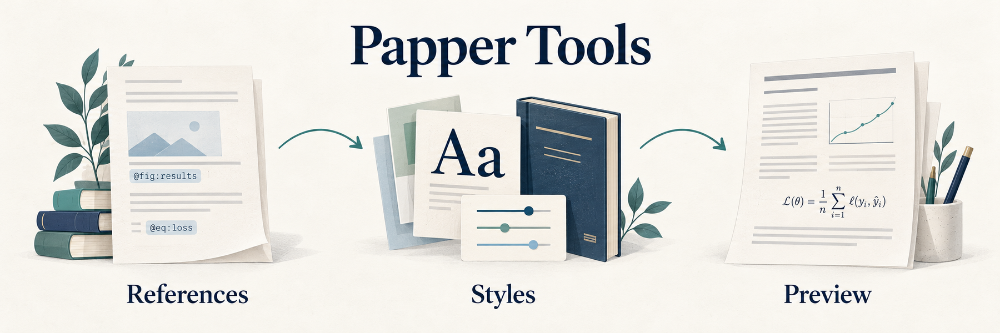

[English](README.md) | [简体中文](README.zh-CN.md)

# Papper Tools

**Write and review Papper manuscripts in VS Code.**

Papper Tools brings reference navigation, equation previews, Word formatting controls, and citation-style search into your Markdown editor. It is the VS Code companion to [Papper](https://github.com/cesaryuan/papper), which builds your manuscript as DOCX.

[Install and use with AI](#install-and-use-with-ai) · [Writing tools](#writing-tools) · [Try-it examples](#try-it-examples) · [Documentation](#documentation)

## Install and use with AI

Install [Papper Tools from the VS Code Marketplace](https://marketplace.visualstudio.com/items?itemName=cesaryuan.pandoc-manuscript-tools). For builds, HTML previews, and rendered reference hints, install [uv](https://docs.astral.sh/uv/getting-started/installation/) and Papper:

```bash
uv tool install papper
```

Open your manuscript folder in VS Code. In an AI agent such as Codex, Claude Code, or Workbuddy, ask:

- “Use Papper to convert this DOCX into Markdown.”
- “Adapt this Markdown file's cross-references, images, tables, and bibliography to Papper's syntax.”
- “Use Papper to build this Markdown file as a DOCX.”

Review the edited source with the extension's navigation, previews, and formatting tools. To start a new paper yourself:

```bash
papper init my-paper
cd my-paper
```

Open that folder in VS Code and edit `manuscript.md`. If uv is already installed, **Papper Tools: Install or Update Papper** can also install or update Papper from the Command Palette.



*AI-generated workflow illustration. It represents the tools' roles rather than an actual editor screenshot.*

## Writing tools

| While writing | What you can do |
| --- | --- |
| Follow figures, tables, equations, and sections | Jump to labels, find references, complete labels after `@`, and spot missing references or duplicate labels |
| Check citation and reference text | See Papper's rendered numbering and citation text beside the source, including grouped citations |
| Adjust Word formatting | Open **Papper: 打开设置** for MathType, fonts, tables, images, page layout, and cross-references; apply manuscript, project, or reply settings |
| Choose a journal's citation style | Search Zotero styles and the Chinese community collection, compare citation and bibliography previews, and apply a local CSL file |
| Inspect equations and figures | Hover over math or local SVG/EMF/WMF images; browse image folders in grid, masonry, or folder layouts |
| Review a revision | Fold revision attributes and line-reference excerpts; navigate from `reply_to_reviewers.md` to labels in the workspace-root `manuscript.md` |

Configuration keys, values, table attributes, and `[]{t="..."}` insertions also have completion and hover help. Style actions on headings, text, images, and tables let you edit the relevant Word formatting without searching through every setting.

## Try-it examples

Save this as a Markdown file:

```markdown
# Methods {#sec:methods}

We minimize the objective in [@eq:loss].

$$
L = \frac{1}{N}\sum_{i=1}^{N}(y_i-\hat{y}_i)^2
$$ {#eq:loss}
```

- Type `@` to complete a reference, or use **Go to Definition** on `@eq:loss`.
- Hover over the formula to see its rendered form. Open Outline to navigate headings and labeled elements.
- Hover over a heading or paragraph to open its style action, or run **Papper: 打开设置**.
- Run **Papper: 设置参考文献样式** to search and compare journal styles.

In a Papper project, `style.yml` holds reusable formatting. A manuscript's YAML header can hold local overrides. The settings window writes changes back to those editable files.

## Preview and build Word

Use these commands from the Command Palette, or the corresponding buttons above a saved Markdown editor:

| Command | Result |
| --- | --- |
| **Papper Tools: Preview Markdown (Papper HTML)** | Open a side preview that includes unsaved changes and follows source navigation |
| **Papper Tools: Build DOCX and Open in Word** | Save the source, build a fresh temporary DOCX, and open it in Word |
| **Papper: 打开设置** | Edit formatting and reference settings |
| **Papper: 设置参考文献样式** | Open the bibliography section with journal search and previews |

Each Word build uses its own temporary file. Use **Save As** in Word to keep a permanent copy. To create the normal project output, run:

```bash
papper build docx
```

HTML helps you check content while writing; inspect final pagination in Word. See [Papper's actual Word examples](https://github.com/cesaryuan/papper#output-examples) for manuscript and reviewer-reply output, including editable MathType equations.

## More editing conveniences

Right-click an image folder and choose **View Images** to browse its contents. SVG, EMF, and WMF files also have dedicated previews.

English paragraph and code-comment translation is available on hover. This uses Google Translate or Microsoft Translator; turn off `pandocManuscriptTools.enableParagraphHoverTranslation` in Settings if you do not want translation requests.

## Documentation

| Looking for | Start here |
| --- | --- |
| Editing, configuration help, extension settings, and troubleshooting | [Editor guide](docs/editor-guide.md) |
| Papper authoring and Word formatting | [Papper documentation](https://github.com/cesaryuan/papper#documentation) |
| Local extension development, checks, and packaging | [Development](DEVELOPMENT.md) |
| Scanner, configuration contracts, and preview implementation | [Implementation notes](docs/editor-internals.md) |
| Changes between releases | [Changelog](CHANGELOG.md) |

For a problem, [open an issue](https://github.com/cesaryuan/vscode-pandoc-manuscript-tools/issues) with the extension version, Papper version where relevant, and a small example. Build and preview logs are in **View → Output → Papper Tools**.

Licensed under [GPL-3.0-or-later](LICENSE).
